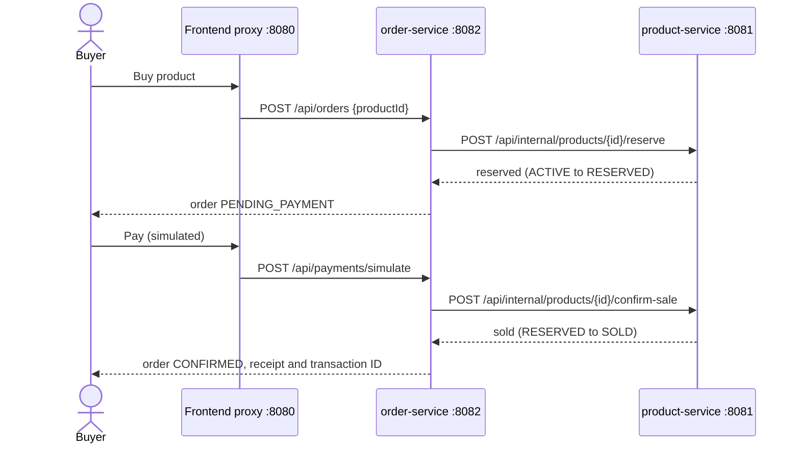
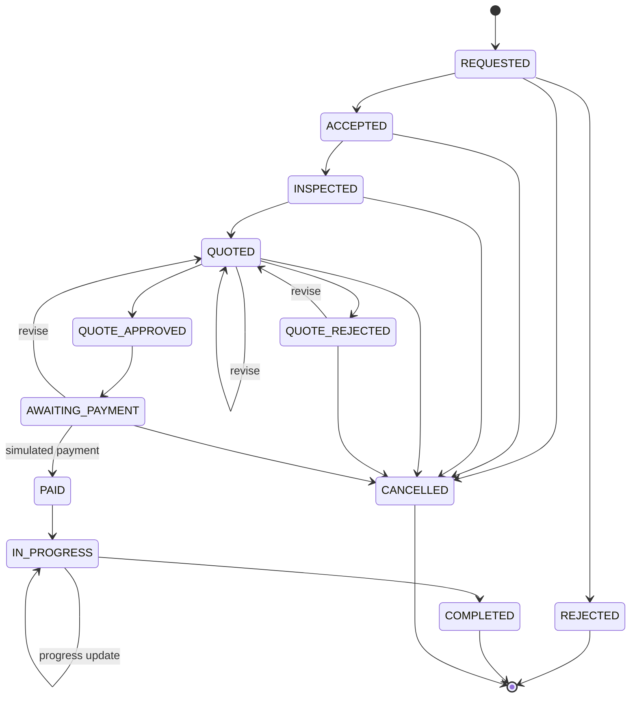
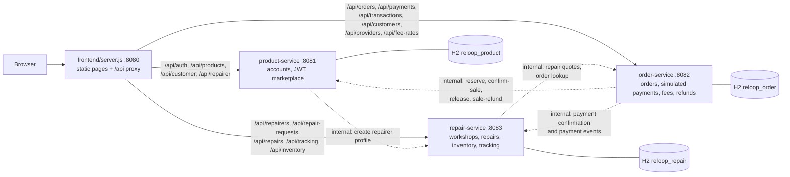
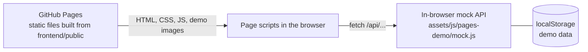
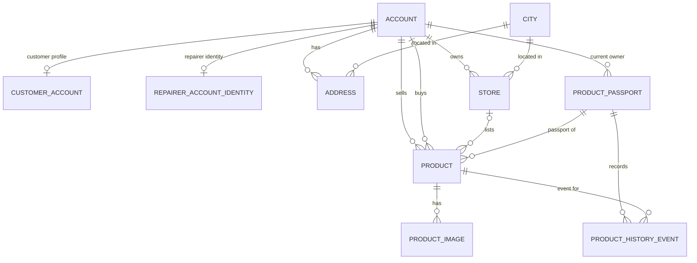
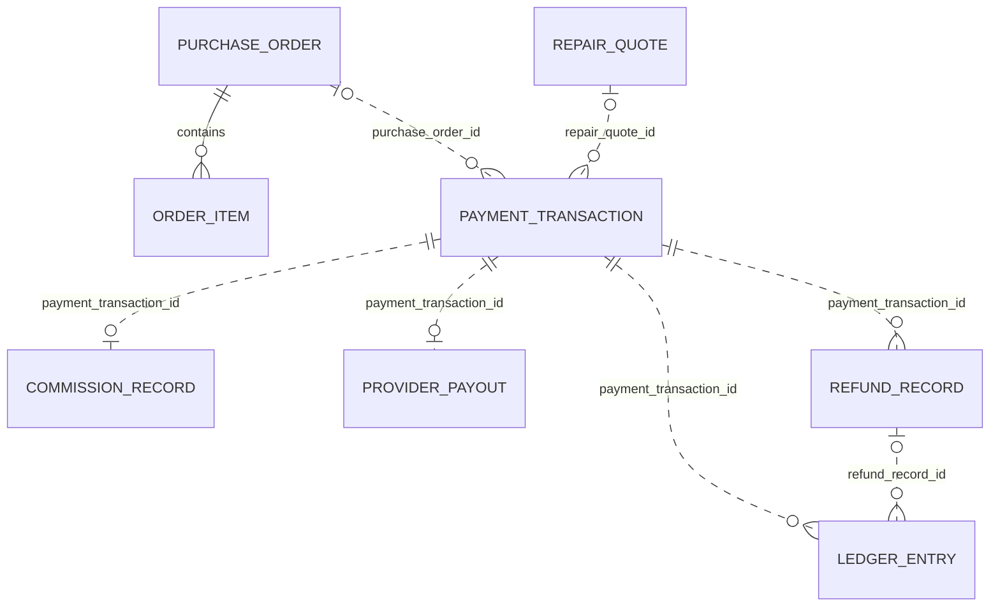
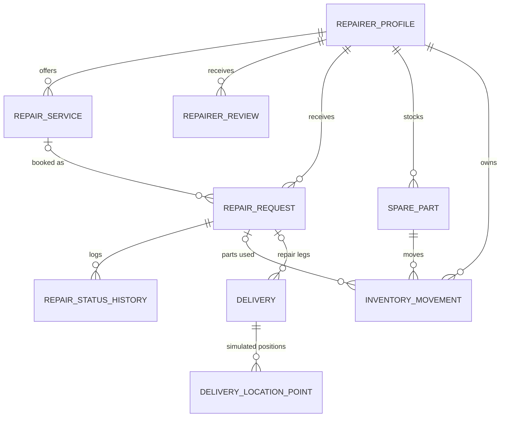

# ReLoop

**Give Products a Second Life.**

ReLoop is a circular commerce platform for buying and selling pre-owned products and connecting customers with local repair services. It is a student project: three Spring Boot services and a static web frontend, all running locally with file-based H2 databases.

**Live demo:** <https://darshankalburgi19.github.io/reloop/> (frontend only, running on demo data in your browser; see [Live demo](#live-demo)).

> **Demo scope.** Payments and delivery tracking are **simulated**. No money moves, no payment gateway is contacted, and no GPS device or courier service is involved. The online demo runs without the Java services: an in-browser mock answers all API calls.

## Table of contents

1. [Live demo](#live-demo)
2. [About](#about)
3. [Problem statement](#problem-statement)
4. [Solution](#solution)
5. [Key features](#key-features)
6. [User roles and permissions](#user-roles-and-permissions)
7. [How the marketplace works](#how-the-marketplace-works)
8. [How the repair process works](#how-the-repair-process-works)
9. [Payment and commission model](#payment-and-commission-model)
10. [Tech stack](#tech-stack)
11. [Architecture](#architecture)
12. [Folder structure](#folder-structure)
13. [Database design](#database-design)
14. [Installation and setup (Windows)](#installation-and-setup-windows)
15. [How to run](#how-to-run)
16. [API documentation](#api-documentation)
17. [Testing](#testing)
18. [Screenshots](#screenshots)
19. [Future scope and roadmap](#future-scope-and-roadmap)
20. [Security considerations](#security-considerations)
21. [Team and contribution](#team-and-contribution)
22. [Further documentation](#further-documentation)

---

## Live demo

<https://darshankalburgi19.github.io/reloop/>

The live demo is the ReLoop frontend (the same pages and theme as `frontend/public`) hosted on GitHub Pages. GitHub Pages can only serve static files, so the three Spring Boot services do not run there. Instead, the in-memory mock API from `frontend/dev/mock-api.js` runs inside the browser and answers every `/api/...` call. A **"Mock backend"** banner at the top of each page shows this.

What you can try:

- Browse the marketplace and repair workshops, open product passports and workshop profiles.
- Register a new account, or sign in with the demo accounts listed in [docs/AUTH.md](docs/AUTH.md) (customer Asha, repairer Ravi).
- As a customer: list an item, buy a product and pay with a simulated payment (success, decline or cancel), send a repair request, approve a quote and follow a simulated delivery.
- As a repairer: accept and quote repair requests, manage services, spare-parts inventory and earnings.

Limitations:

| Topic | Live demo behaviour |
|---|---|
| Backend | No Java services and no H2 databases; the mock follows the same request and response shapes |
| Data | Stored in the visitor's own browser (`localStorage`); other visitors do not see it |
| Accounts | Demo accounts and new registrations exist only in that browser's mock data |
| Payments and tracking | Simulated, as in the full stack |
| Reset | Open any page with `?reset-demo` added to the URL to restore the original demo data |

How it is published: the workflow [.github/workflows/pages.yml](.github/workflows/pages.yml) runs [frontend/pages-demo/build.js](frontend/pages-demo/build.js) on every push that changes the frontend, and deploys the result with GitHub Actions (repository setting **Pages → Source: GitHub Actions**). The build copies `frontend/public` into a separate folder, prefixes root paths with `/reloop`, copies the demo images and adds the browser mock. The source files are not modified. Details: [frontend/pages-demo/README.md](frontend/pages-demo/README.md).

## About

ReLoop combines two activities that usually live on separate platforms:

- **A second-hand marketplace.** Customers list used items (electronics, furniture, books and more), and other customers buy them.
- **A repair network.** Customers find a repair workshop nearby, send a repair request, receive a quote and pay for the repair. Repairers manage their jobs, services, spare-parts inventory and earnings from their own dashboard.

Each listed item gets a **product passport**: a history of listing, price changes, reservation and sale events that stays with the item when it is resold.

## Problem statement

Many usable products are thrown away because selling them is inconvenient or a small fault makes them look worthless. Buyers of second-hand goods often know little about an item's history. Finding a trustworthy local repairer, comparing prices and following the progress of a repair is usually done informally, by phone or in person, with no record of quotes or payments.

## Solution

ReLoop puts reselling and repairing in one place:

- One account type for **customers** (who can both buy and sell) and one for **repairers** (workshops).
- A marketplace with listings, product passports, reservation on checkout and a recorded sale.
- A repair workflow with explicit states (request, inspection, quote, approval, payment, work, completion) and a full status history.
- A transparent fee model: a 2% customer fee and a 2% provider commission, with receipts, ledger entries, payouts and refunds.
- Simulated delivery tracking for marketplace orders and for repair pick-up and return legs.

## Key features

Status labels:

- **Implemented**: present in the code and covered by automated tests.
- **Partially implemented**: a data model or read-only view exists, but parts of the flow are missing.
- **Planned**: not in the code.

| Area | Feature | Status |
|---|---|---|
| Accounts | Customer and repairer registration, login with JWT, `GET /api/auth/me` | Implemented |
| Accounts | Role separation: a customer can never become a repairer, and vice versa | Implemented |
| Marketplace | Browse, search and filter listings; product detail; create, edit and delete own listings | Implemented |
| Marketplace | Product passport with history events (listed, price changed, reserved, sold, refunded and others) | Implemented |
| Marketplace | Checkout: order creation reserves the product; unpaid orders are cancelled after 30 minutes | Implemented |
| Marketplace | Product images as URLs (bundled demo SVGs or `https://` links); no file upload | Partially implemented |
| Marketplace | Stores: products can belong to a seller's store, but there is no API to create or manage stores (only the demo seeder creates one) | Partially implemented |
| Repairs | Repairer workshop profiles, services with prices, working hours, categories, location | Implemented |
| Repairs | Nearby workshop search by distance (haversine), with a Leaflet / OpenStreetMap map in the UI | Implemented |
| Repairs | Repair request workflow with 12 states, quotes, quote revision, cancellation and status history | Implemented |
| Repairs | Repairer reviews are stored and the latest five are shown on a profile, but there is no endpoint to submit a review (only seeded demo reviews exist) | Partially implemented |
| Repairs | Repairer verification status (UNVERIFIED / VERIFIED / REJECTED) is stored and shown, but there is no verification workflow; only seeded demo workshops are VERIFIED | Partially implemented |
| Inventory | Spare parts per workshop: stock in, use in a repair, adjust, discontinue, low-stock report, movement history | Implemented |
| Payments | Simulated payment (SUCCESS / FAILED / CANCELLED) for marketplace orders and repair quotes | Implemented (simulated) |
| Payments | Fee calculation, receipts, double-entry ledger, commission records, provider payout records | Implemented |
| Payments | Full and partial refunds issued by the provider, with idempotency keys | Implemented |
| Payments | Actual payout to sellers and repairers: payout records stay `PENDING` and no code marks them `PAID` | Planned |
| Tracking | Delivery legs (store to customer, customer to repairer, repairer to customer) moved along predefined Gujarat demo points by an "advance" call | Implemented (simulated) |
| Dashboards | Customer and repairer dashboards (listings, sales, purchases, repairs, jobs, earnings, payments, inventory) with periodic polling | Implemented |
| Frontend | Mock backend (`node server.js --mock`) for UI work without Java | Implemented |
| Frontend | Static live demo on GitHub Pages with the mock API running in the browser | Implemented |
| Platform | Admin role, admin console or moderation | Planned (no admin role exists) |
| Platform | Email, SMS or push notifications | Planned |
| Platform | Real payment gateway, real GPS or courier tracking, deployment of the backend services | Planned |

## User roles and permissions

The system has exactly two roles, defined in `AccountRole`: `CUSTOMER` and `REPAIRER`. There is no admin role. Service-to-service calls use a shared internal API key instead of a user role.

| Capability | Visitor (no login) | Customer | Repairer |
|---|---|---|---|
| Browse listings, product detail and passport | Yes | Yes | Yes |
| Browse workshops and view a workshop profile | Yes | Yes | Yes |
| Register and log in | Yes | n/a | n/a |
| Create, edit and delete own listings | No | Yes | No (403) |
| Buy a product (create an order, simulated payment) | No | Yes | No |
| Send a repair request, approve or reject a quote, pay for a repair | No | Yes | No |
| Accept, reject, inspect, quote, progress and complete repair requests | No | No | Yes (own workshop only) |
| Edit workshop profile, services, hours and location | No | No | Yes (own workshop only) |
| Manage spare-parts inventory | No | No | Yes (own workshop only) |
| Issue a refund for a payment they received | No | Yes (as a seller) | Yes (for a repair payment) |
| View own payments, earnings and payouts | No | Yes | Yes |
| View and advance a simulated delivery | No | Parties to the delivery only | Parties to the delivery only |

The rules are enforced in each service's `SecurityConfig` (URL level), in controllers (`@PreAuthorize`) and in the service layer (ownership checks). For example, a buyer cannot refund their own payment, and a repairer can only act on requests sent to their own workshop.

## How the marketplace works

1. A customer creates a listing (`POST /api/products`) with title, category, condition, price and image URLs. The product becomes `ACTIVE` and a product passport records a `LISTED` event.
2. Another customer starts checkout. order-service creates an order (`POST /api/orders`) and asks product-service to **reserve** the product (`ACTIVE` → `RESERVED`). The order is `PENDING_PAYMENT`.
3. The buyer pays with the **simulated** payment endpoint (`POST /api/payments/simulate`).
   - **Success:** the order becomes `CONFIRMED` and product-service records the sale (`RESERVED` → `SOLD`).
   - **Failure or cancellation:** the order stays open until it is cancelled or expires.
4. Unpaid orders are cancelled after 30 minutes by a background sweep that runs every 60 seconds, and the reservation is released (`RESERVED` → `ACTIVE`).
5. The seller can issue a full or partial refund. The order becomes `REFUNDED` or `PARTIALLY_REFUNDED` and product-service records a `SALE_REFUNDED` passport event.
6. Either party can follow a simulated `STORE_TO_CUSTOMER` delivery for a paid order.



The legacy endpoint `POST /api/products/{id}/purchase` still exists but is disabled by default (`RELOOP_DIRECT_PURCHASE_ENABLED=false`). All purchases go through order-service. Details: [docs/MARKETPLACE.md](docs/MARKETPLACE.md).

## How the repair process works

1. The customer finds a workshop (list, map or nearby search) and sends a repair request (`POST /api/repair-requests`). Only a workshop whose profile is complete and active accepts requests.
2. The repairer accepts or rejects the request, then inspects the item and sends a quote. repair-service registers the quote with order-service.
3. The customer approves or rejects the quote. The repairer can revise an unpaid quote.
4. After approval the request waits for payment. The customer pays with `POST /api/payments/simulate` (using `repairQuoteId`), and order-service notifies repair-service, which moves the request to `PAID`.
5. The repairer records progress and completes the repair, and can record spare parts used for that request from the inventory.
6. A full refund of a paid repair that is not yet complete closes it as `CANCELLED`.

Every transition is stored in `repair_status_history` with the actor (`CUSTOMER`, `REPAIRER` or `SYSTEM`). Allowed transitions, from `RepairTransitions.java`:



The refund rule (a full refund closes a `PAID` or `IN_PROGRESS` repair as `CANCELLED`) is applied separately in `RepairRequestService`, so it is not drawn above. Details: [docs/REPAIR_WORKFLOW.md](docs/REPAIR_WORKFLOW.md) and [docs/REPAIRERS.md](docs/REPAIRERS.md).

## Payment and commission model

All payments are **simulated**. `POST /api/payments/simulate` accepts a method (`UPI`, `CARD`, `NET_BANKING` or `WALLET`) and an outcome (`SUCCESS`, `FAILED` or `CANCELLED`). There are deliberately no fields for card numbers, CVV, UPI PINs or bank details.

| Item | Rule |
|---|---|
| Customer fee | 2% of the base price, added on top (`RELOOP_CUSTOMER_FEE_RATE`, default `0.02`) |
| Provider commission | 2% of the base price, deducted from the seller or repairer (`RELOOP_PROVIDER_COMMISSION_RATE`, default `0.02`) |
| Rounding | Each fee is rounded HALF_UP to the nearest paisa; amounts are stored as whole paise (`long`) |
| Example | Base ₹1,000.00: customer pays ₹1,020.00, provider receives ₹980.00, platform keeps ₹40.00 |
| Records | Payment transaction (`TXN-…`), order (`ORD-…`), receipt, ledger entries, commission record, provider payout (status `PENDING`) |
| Refunds | All or part of the base price, issued by the provider. Fee and commission are reversed in proportion. Refund IDs start with `RFD-`. An `Idempotency-Key` header makes retries safe. |
| Payouts | Recorded, not executed: no money is transferred to providers |

Fee rates can be read with `GET /api/fee-rates` and changed through internal endpoints. Details: [docs/PAYMENTS.md](docs/PAYMENTS.md).

## Tech stack

| Layer | Technology |
|---|---|
| Language | Java 21 |
| Backend framework | Spring Boot 3.5.16 (Web, Data JPA, Security, Validation, Actuator) |
| Authentication | JWT (HS256) with `io.jsonwebtoken` (jjwt) 0.12.6, BCrypt password hashing |
| Database | H2, file-based, one database per service |
| Build | Maven (no Maven wrapper is included) |
| Frontend | Static HTML, CSS and vanilla JavaScript; Bootstrap 5.3.3 and Bootstrap Icons 1.11.3 (CDN with SRI) |
| Maps | Leaflet 1.9.4 with OpenStreetMap tiles |
| Frontend server | `frontend/server.js`: a dependency-free Node.js server (Node 18+) that serves pages and proxies `/api` |
| Testing | JUnit 5 and Spring Boot Test (spring-boot-starter-test), spring-security-test (product-service), Node static checks, Bash/curl/jq end-to-end scripts |
| CI | GitHub Actions ([.github/workflows/ci.yml](.github/workflows/ci.yml)) |
| Hosting (demo) | GitHub Pages, deployed by GitHub Actions ([.github/workflows/pages.yml](.github/workflows/pages.yml)); frontend and browser mock only |

## Architecture

ReLoop is split into **three independent Spring Boot services** and a **Node.js frontend server**. Each service has its own H2 database; there is no shared database and no message broker. Services talk to each other only over REST. Internal endpoints (`/api/internal/**`) are protected by a shared `X-Internal-Api-Key` header, and the frontend proxy never forwards them.



- **product-service** is the identity provider. It registers accounts, hashes passwords and issues JWTs. The other two services verify the same JWT with a shared secret.
- **order-service** owns orders, simulated payments, fee rates, ledger, commissions, payouts, refunds and repair quotes.
- **repair-service** owns workshop profiles, services, reviews, repair requests, spare-parts inventory and simulated deliveries.
- **frontend** serves pages and routes each `/api/...` prefix to the right service, so the browser talks to one origin and no CORS setup is needed.

More: [docs/ARCHITECTURE.md](docs/ARCHITECTURE.md), [docs/INTEGRATION.md](docs/INTEGRATION.md), and the cross-service contract samples in [contracts/](contracts/).

### Live demo architecture

The GitHub Pages demo replaces the Node server and the three services with static files and a mock that runs in the browser:



## Folder structure

```text
reloop/
├── .github/workflows/
│   ├── ci.yml                   # CI: Maven verify per service, frontend checks, end-to-end run
│   └── pages.yml                # Builds and deploys the GitHub Pages live demo
├── contracts/                   # JSON samples for each service-to-service call
│   ├── order-to-product/
│   ├── order-to-repair/
│   ├── product-to-repair/
│   └── repair-to-order/
├── docs/                        # Design and feature documentation (see "Further documentation")
├── frontend/
│   ├── server.js                # Static server + /api proxy (--mock for the in-memory API)
│   ├── dev/mock-api.js          # Mock backend used by --mock
│   ├── scripts/check.js         # Static checks run by `npm test`
│   ├── pages-demo/              # Live demo build: build.js, browser-mock.js, README.md
│   └── public/                  # HTML pages, customer/ and repairer/ dashboards, assets/{css,img,js}
├── product-service/             # Spring Boot, port 8081, package com.reloop.product
├── order-service/               # Spring Boot, port 8082, package com.reloop.orderpayment
├── repair-service/              # Spring Boot, port 8083, package com.reloop.repair
└── scripts/e2e/                 # start-stack.sh, run-all.sh and four scenario scripts
```

Each service follows the same layout under `src/main/java/com/reloop/<service>/`: `controller`, `service`, `repository`, `entity`, `enums`, `dto`, `security`, `config`, `client` (REST clients for other services), `exception` and `health`. `src/main/resources/` holds `application.properties`, and `static/demo-images/` holds placeholder SVGs.

## Database design

Each service owns one H2 file database, created in a `data/` folder inside the service directory when the service starts from there (`spring.jpa.hibernate.ddl-auto=update`). Links between services are plain ID columns (for example `buyer_account_id` or `repair_request_external_id`), not foreign keys.

| Service | Database | Tables |
|---|---|---|
| product-service | `reloop_product` | `accounts`, `customer_accounts`, `repairer_account_identities`, `addresses`, `cities`, `stores`, `products`, `product_images`, `product_passports`, `product_history_events` |
| order-service | `reloop_order` | `purchase_orders`, `order_items`, `payment_transactions`, `fee_rate_configs`, `commission_records`, `provider_payouts`, `refund_records`, `ledger_entries`, `repair_quotes` |
| repair-service | `reloop_repair` | `repairer_profiles`, `repairer_profile_categories`, `repairer_working_hours`, `repair_services`, `repairer_reviews`, `repair_requests`, `repair_request_images`, `repair_status_history`, `repair_payment_events`, `spare_parts`, `inventory_movements`, `deliveries`, `delivery_location_points` |

Simplified relationships (from the JPA entities; dashed lines in order-service are ID references rather than JPA associations):







`fee_rate_configs` (order-service) and `repair_payment_events` (repair-service) are standalone tables. Column-level detail: [docs/ER_DIAGRAM.md](docs/ER_DIAGRAM.md) and [docs/SCHEMA.md](docs/SCHEMA.md).

## Installation and setup (Windows)

### 1. Install the tools

| Tool | Version | Notes |
|---|---|---|
| JDK | 21 (for example Eclipse Temurin 21) | Set `JAVA_HOME` and add `%JAVA_HOME%\bin` to `PATH` |
| Maven | 3.9 or newer | Unzip (for example to `C:\maven`) and add `C:\maven\bin` to `PATH`. The repo has no `mvnw` wrapper. |
| Node.js | 18 or newer (CI uses 20 LTS) | Only for the frontend server; it has no npm dependencies |
| Git for Windows | any recent | Includes Git Bash, needed only for the end-to-end scripts |
| jq | any recent | Only for the end-to-end scripts: `winget install jqlang.jq` |

Check the installation in a new PowerShell window:

```powershell
java -version
mvn -v
node -v
git --version
```

### 2. Clone the repository

```powershell
git clone https://github.com/DarshanKalburgi19/reloop.git
cd reloop
```

### 3. Configuration

No configuration is required for local development: each `application.properties` contains development defaults. Override them with environment variables when needed:

| Variable | Used by | Default / purpose |
|---|---|---|
| `RELOOP_JWT_SECRET` | all services | JWT signing key. Must be identical in all three services. The dev default is for local use only. |
| `RELOOP_INTERNAL_API_KEY` | all services | Shared key for `/api/internal/**` (`X-Internal-Api-Key` header). Must be identical in all three services. |
| `RELOOP_CUSTOMER_FEE_RATE` | order-service | `0.02` |
| `RELOOP_PROVIDER_COMMISSION_RATE` | order-service | `0.02` |
| `RELOOP_DIRECT_PURCHASE_ENABLED` | product-service | `false` (keeps the legacy purchase endpoint disabled) |
| `RELOOP_PRODUCT_SERVICE_URL`, `RELOOP_REPAIR_SERVICE_URL` | order-service | `http://localhost:8081`, `http://localhost:8083` |
| `RELOOP_ORDER_SERVICE_URL` | repair-service | `http://localhost:8082` |
| `RELOOP_SEED_ENABLED` | repair-service | `true` (seeds demo workshops) |
| `RELOOP_TRACKING_SPEED_KMPH`, `RELOOP_TRACKING_PICKUP_LEAD_MINUTES` | repair-service | `40`, `45` (simulated tracking timing) |
| `PORT`, `HOST`, `PRODUCT_API`, `ORDER_API`, `REPAIR_API` | frontend/server.js | `8080`, `0.0.0.0`, and the three service URLs |

product-service reaches repair-service at `reloop.services.repair.base-url` (`http://localhost:8083`). This value is set directly in its `application.properties` and has no environment variable.

Example (PowerShell, current window only):

```powershell
$env:RELOOP_CUSTOMER_FEE_RATE = "0.02"
```

## How to run

### Full stack (four PowerShell windows)

Start the services in this order. product-service seeds a demo repairer through repair-service, so repair-service should be running first.

```powershell
# Window 1
cd reloop\repair-service
mvn spring-boot:run

# Window 2
cd reloop\order-service
mvn spring-boot:run

# Window 3
cd reloop\product-service
mvn spring-boot:run

# Window 4
cd reloop\frontend
node server.js
```

Open <http://localhost:8080>. Health checks: `http://localhost:8081/api/health`, `:8082/api/health` and `:8083/api/health`.

Demo accounts (one customer and one repairer, plus extra demo sellers) are seeded on first start. Their emails and local-only passwords are listed in section 3 of [docs/AUTH.md](docs/AUTH.md). They are for local development only.

On a completely fresh database the seeded demo repairer's workshop profile is incomplete, so it does not accept repair requests until its profile is completed (description, categories, a priced service and working hours). The end-to-end scripts do this automatically; see [docs/INTEGRATION.md](docs/INTEGRATION.md).

### Frontend only (no Java)

```powershell
cd reloop\frontend
node server.js --mock
```

All `/api` calls are answered from the in-memory mock in `frontend/dev/mock-api.js`, and the UI shows a mock banner.

### Live demo build (GitHub Pages)

To build the same static site that is published to GitHub Pages:

```powershell
node frontend/pages-demo/build.js --out C:\temp\pages\reloop --base /reloop
python -m http.server 8000 -d C:\temp\pages
```

Then open <http://localhost:8000/reloop/>. The second command needs Python; any static file server works. Keep the output folder outside the repository so generated files are not committed.

### H2 console

Each service exposes `/h2-console` for local inspection, for example <http://localhost:8081/h2-console> with JDBC URL `jdbc:h2:file:./data/reloop_product`. The credentials are in that service's `application.properties`.

### Reset the data

Stop the services and delete the `data\` folder inside `product-service`, `order-service` and `repair-service`.

### macOS / Linux (or Git Bash)

```bash
bash scripts/e2e/start-stack.sh            # build missing jars, start the 3 services + frontend, wait until ready
bash scripts/e2e/start-stack.sh --fresh    # same, with clean databases
bash scripts/e2e/start-stack.sh --stop     # stop everything it started
```

`start-stack.sh` is run in CI on Ubuntu. It has not been verified on Windows Git Bash, so on Windows the four-window method above is the supported path.

## API documentation

All endpoints below exist in the controllers. Calls through the frontend use the same paths on port 8080.

- **Auth header:** `Authorization: Bearer <token>`, with the token from `POST /api/auth/login`.
- **Errors:** JSON in the form `{status, error, message, path, fieldErrors}`.
- **Health:** every service has `GET /api/health` and `/actuator/health` (both public).

### product-service (:8081)

| Method | Path | Access | Purpose |
|---|---|---|---|
| POST | `/api/auth/register/customer` | Public | Register a customer |
| POST | `/api/auth/register/repairer` | Public | Register a repairer (also creates the workshop profile in repair-service) |
| POST | `/api/auth/login` | Public | Log in and receive a JWT |
| GET | `/api/auth/me` | Any token | Current account |
| GET | `/api/customer/dashboard` | CUSTOMER | Customer dashboard summary |
| GET | `/api/repairer/dashboard` | REPAIRER | Repairer dashboard summary |
| GET | `/api/products` | Public | Browse listings; query params `q`, `category`, `city`, `condition`, `minPrice`, `maxPrice`, `sort`, `page`, `size` |
| GET | `/api/products/{id}` | Public | Product detail |
| GET | `/api/products/{id}/passport` | Public | Product passport and history |
| GET | `/api/products/mine` | CUSTOMER | Own listings |
| POST | `/api/products` | CUSTOMER | Create a listing |
| PUT | `/api/products/{id}` | CUSTOMER (owner) | Edit a listing |
| DELETE | `/api/products/{id}` | CUSTOMER (owner) | Remove a listing |
| POST | `/api/products/{id}/purchase` | CUSTOMER | Legacy direct purchase, disabled by default |
| POST | `/api/internal/products/{id}/reserve`, `/confirm-sale`, `/release`, `/sale-refund` | Internal key | Used by order-service |

### order-service (:8082)

| Method | Path | Access | Purpose |
|---|---|---|---|
| POST | `/api/orders` | Any token (buyer) | Create an order for a product (reserves it) |
| GET | `/api/orders` | Any token | Own orders |
| GET | `/api/orders/{id}` | Order parties | Order detail |
| POST | `/api/orders/{id}/cancel` | Buyer | Cancel an unpaid order |
| POST | `/api/payments/simulate` | Any token (payer) | Simulated payment for an order or a repair quote (`Idempotency-Key` header supported) |
| GET | `/api/payments/{transactionId}` | Parties | Payment status |
| GET | `/api/transactions/{transactionId}` | Parties | Transaction detail |
| GET | `/api/transactions/{transactionId}/receipt` | Parties | Receipt (demo, not a tax invoice) |
| GET | `/api/transactions/{transactionId}/ledger` | Parties | Ledger entries |
| POST | `/api/transactions/{transactionId}/refunds` | Provider who was paid | Full or partial refund (`Idempotency-Key` header supported) |
| GET | `/api/customers/{id}/payments` | That customer | Payment history |
| GET | `/api/providers/{id}/earnings` | That provider | Earnings summary |
| GET | `/api/providers/{id}/payouts` | That provider | Payout records |
| GET | `/api/fee-rates` | Any token | Current fee and commission rates |
| PUT, DELETE | `/api/internal/fee-rates/{type}` | Internal key | Change or reset a fee rate |
| GET | `/api/internal/orders/{id}` | Internal key | Order lookup (used by repair-service tracking) |
| POST | `/api/internal/transactions/{transactionId}/refunds` | Internal key | Support-initiated refund |
| POST | `/api/internal/repair-quotes` | Internal key | Register a repair quote |
| GET | `/api/internal/repair-quotes/{id}` | Internal key | Quote detail |
| POST | `/api/internal/repair-quotes/{id}/approve`, `/reject` | Internal key | Record the customer's decision |

### repair-service (:8083)

| Method | Path | Access | Purpose |
|---|---|---|---|
| GET | `/api/repairers` | Public | List and search workshops |
| GET | `/api/repairers/nearby` | Public | Workshops by distance from a point |
| GET | `/api/repairers/{id}` | Public | Workshop profile, services and latest reviews |
| GET | `/api/repairers/me` | REPAIRER | Own workshop profile |
| POST | `/api/repairers` | REPAIRER | Create a workshop profile |
| PUT | `/api/repairers/{id}` | REPAIRER (owner) | Update profile, services, hours and location |
| POST | `/api/repairer-profiles` | Internal key | Create a profile at registration (called by product-service) |
| GET | `/api/repairer-profiles/{id}` | Internal key | Profile lookup |
| POST | `/api/repair-requests` | Customer | Send a repair request |
| GET | `/api/repair-requests/mine` | Customer | Own requests |
| GET | `/api/repair-requests/incoming` | Repairer | Requests sent to own workshop |
| GET | `/api/repair-requests/demo-images` | Public | Bundled placeholder images |
| GET | `/api/repair-requests/{id}` | Parties | Request detail |
| GET | `/api/repair-requests/{id}/history` | Parties | Status history |
| POST | `/api/repair-requests/{id}/accept`, `/reject`, `/inspect`, `/quote`, `/quote/revise`, `/progress`, `/complete` | Repairer (owner) | Repairer workflow actions |
| POST | `/api/repair-requests/{id}/quote/approve`, `/quote/reject` | Customer (owner) | Quote decision |
| POST | `/api/repair-requests/{id}/cancel` | Parties | Cancel (allowed states depend on the role) |
| PATCH | `/api/repair-requests/{id}/status` | Parties | Generic status change, validated against the same rules |
| POST | `/api/repairs/{id}/quote`, `/api/repairs/{id}/approve` | Repairer / Customer | Short aliases for quote and approve |
| GET, POST | `/api/inventory/parts` | REPAIRER | List or add spare parts |
| GET, PATCH | `/api/inventory/parts/{id}` | REPAIRER (owner) | Part detail or update |
| POST | `/api/inventory/parts/{id}/stock-in`, `/use`, `/adjust`, `/discontinue`, `/reactivate` | REPAIRER (owner) | Stock movements and status |
| GET | `/api/inventory/parts/{id}/movements`, `/api/inventory/movements` | REPAIRER | Movement history |
| GET | `/api/inventory/summary`, `/api/inventory/low-stock` | REPAIRER | Inventory overview |
| GET | `/api/inventory/repair-requests/{id}/parts` | REPAIRER (owner) | Parts used in a repair |
| GET | `/api/tracking/demo-locations` | Public | Predefined demo locations |
| POST | `/api/tracking/deliveries` | Parties | Book a simulated delivery leg |
| GET | `/api/tracking/deliveries/mine` | Any token | Own deliveries |
| GET | `/api/tracking/deliveries/{trackingNumber}` | Parties | Delivery status and position |
| GET | `/api/tracking/deliveries/{trackingNumber}/history` | Parties | Position history |
| POST | `/api/tracking/deliveries/{trackingNumber}/advance` | Parties | Move the simulation one step (demo) |
| GET | `/api/tracking/repair-requests/{id}/deliveries` | Parties | Deliveries for a repair |
| GET | `/api/tracking/orders/{orderId}/deliveries` | Parties | Deliveries for an order |
| POST | `/api/internal/repair-requests/{id}/payment-confirmation` | Internal key | Mark a repair as paid (called by order-service) |
| POST | `/api/internal/repair-requests/{id}/payment-events` | Internal key | Payment failed, cancelled or refunded events |

"Parties" means the customer and the repairer (or the buyer and the seller) involved in that record; this is checked in the service layer. Request and response examples for internal calls are in [contracts/](contracts/), and feature documents in [docs/](docs/) describe the request bodies.

## Testing

### Automated tests

Each service has JUnit 5 / Spring Boot tests (controller, service, repository, security, contract and seeder tests) that run against an in-memory database.

```powershell
mvn -f product-service/pom.xml verify
mvn -f order-service/pom.xml verify
mvn -f repair-service/pom.xml verify
```

Frontend static checks (JavaScript syntax, internal links, CSP, SRI hashes, proxy routes):

```powershell
cd frontend
npm test
```

End-to-end scenarios (Git Bash, macOS or Linux; needs `curl` and `jq` and a running stack):

```bash
bash scripts/e2e/run-all.sh                            # against http://localhost:8080
BASE_URL=http://localhost:8090 bash scripts/e2e/run-all.sh
```

The four scenarios are `01-marketplace-sale.sh`, `02-repair-flow.sh`, `03-failed-payment.sh` and `04-refund.sh` in [scripts/e2e/](scripts/e2e/).

### Current results

From the last CI run on this branch (commit `c44cb75`):

| Suite | Result |
|---|---|
| product-service | 126 tests, 0 failures |
| order-service | 134 tests, 0 failures |
| repair-service | 173 tests, 0 failures |
| Frontend checks | 125 checks passed (42 JS files, 32 HTML pages) |
| End-to-end, mock backend and real services | 4 scenarios passed |

CI ([.github/workflows/ci.yml](.github/workflows/ci.yml)) runs `mvn verify` for each service, the frontend checks with a mock-backend smoke test, and the four scenarios against the real three-service stack. A separate workflow ([.github/workflows/pages.yml](.github/workflows/pages.yml)) builds the live demo, checks the generated JavaScript and deploys it to GitHub Pages. Code-coverage percentages are not measured (no coverage tool is configured).

## Screenshots

No screenshots are committed to the repository. The only image assets are the favicon (`frontend/public/assets/img/favicon.svg`) and placeholder SVGs used as demo product and repair images:

- `product-service/src/main/resources/static/demo-images/placeholders/`
- `repair-service/src/main/resources/static/demo-images/repairs/`

To see the UI, open the [live demo](https://darshankalburgi19.github.io/reloop/) or run `node server.js --mock` in `frontend/` and open <http://localhost:8080>.

## Future scope and roadmap

These items are **not implemented**:

- Real payment gateway integration and actual payouts to sellers and repairers (payout records are currently `PENDING` only).
- Real delivery tracking through a courier API or GPS.
- An admin role for moderation, repairer verification, disputes and fee management (fee rates can currently be changed only through internal endpoints).
- Customer reviews submitted through the API (reviews are currently seeded only).
- Store management for sellers (create and edit stores).
- Image upload and storage (listings currently use URLs).
- Email, SMS or push notifications (dashboards currently poll for updates).
- A production database (for example PostgreSQL), containerisation and deployment of the backend services. Only the frontend demo is deployed (GitHub Pages); there is no Dockerfile or server deployment configuration.
- A Maven wrapper (`mvnw`) for easier setup.

## Security considerations

- **Stateless JWT authentication.** HS256 tokens, valid for one hour, issued only by product-service and verified by all services with a shared secret. No session cookies are used, so CSRF protection is disabled by design.
- **Passwords.** Hashed with BCrypt (work factor 12). Password hashes are never returned in responses. Login errors do not reveal whether an email exists.
- **Role and ownership checks.** URL rules in each `SecurityConfig`, `@PreAuthorize` in controllers, and ownership checks in services. 401 and 403 responses are JSON.
- **Internal endpoints.** `/api/internal/**` requires the `X-Internal-Api-Key` header, and the frontend proxy refuses to forward these paths.
- **No payment data.** The simulated payment API has no fields for card, UPI or bank details.
- **Frontend.** Content-Security-Policy and Permissions-Policy headers on HTML pages, and Subresource Integrity on CDN assets.
- **Local-only defaults.** The JWT secret and internal API key in `application.properties` are development defaults. Set `RELOOP_JWT_SECRET` and `RELOOP_INTERNAL_API_KEY` to strong values for any shared or public environment. The H2 console is enabled for local development and should be disabled outside it.
- **Demo accounts.** The seeded demo accounts and passwords documented in [docs/AUTH.md](docs/AUTH.md) are public. Do not use them outside local development.

Details: [docs/AUTH.md](docs/AUTH.md).

## Team and contribution

The repository is maintained by [DarshanKalburgi19](https://github.com/DarshanKalburgi19). It contains no team list, `CONTRIBUTING` guide or code of conduct.

To contribute:

1. Create a branch from `main`.
2. Run the service tests and `npm test` in `frontend/` before opening a pull request.
3. Keep the documentation in [docs/](docs/) and the samples in [contracts/](contracts/) in sync with any API change.

No license file is included in the repository, so no open-source license has been granted.

## Further documentation

| Document | Topic |
|---|---|
| [docs/ARCHITECTURE.md](docs/ARCHITECTURE.md) | Service boundaries and design |
| [docs/AUTH.md](docs/AUTH.md) | Registration, login, JWT, roles, demo accounts |
| [docs/MARKETPLACE.md](docs/MARKETPLACE.md) | Listings, passports, reservation and sale |
| [docs/PAYMENTS.md](docs/PAYMENTS.md) | Simulated payments, fees, ledger, refunds |
| [docs/REPAIRERS.md](docs/REPAIRERS.md) | Workshop profiles and search |
| [docs/REPAIR_WORKFLOW.md](docs/REPAIR_WORKFLOW.md) | Repair request states and actions |
| [docs/INVENTORY.md](docs/INVENTORY.md) | Spare-parts inventory |
| [docs/DELIVERY_TRACKING.md](docs/DELIVERY_TRACKING.md) | Simulated delivery tracking |
| [docs/FRONTEND.md](docs/FRONTEND.md) | Frontend pages, dev server, mock API |
| [frontend/pages-demo/README.md](frontend/pages-demo/README.md) | GitHub Pages live demo: build, deployment, reset |
| [docs/INTEGRATION.md](docs/INTEGRATION.md) | Service integration and end-to-end scenarios |
| [docs/ER_DIAGRAM.md](docs/ER_DIAGRAM.md), [docs/SCHEMA.md](docs/SCHEMA.md) | Data model |
| [docs/AUDIT_REPORT.md](docs/AUDIT_REPORT.md) | Repository audit of code and REST contracts (written at an earlier commit) |
| [docs/PHASE1.md](docs/PHASE1.md) | Phase 1 foundation: services, databases, health endpoints |
