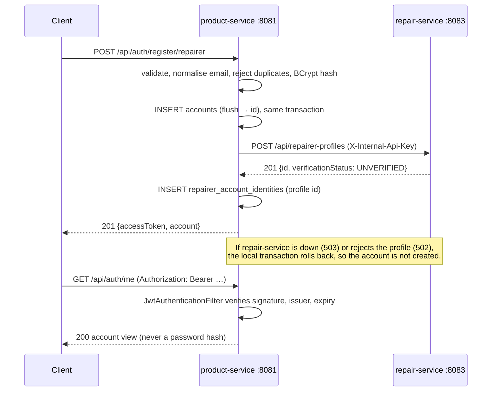

# ReLoop — Account Registration & Authentication

product-service (**:8081**) is the ReLoop identity provider. It owns accounts, hashes
passwords, issues access tokens and enforces roles. repair-service (**:8083**) owns repairer
workshop profiles and is called once, server-to-server, during repairer registration.

## 1. Endpoints

| Method | Path | Access | Result |
|---|---|---|---|
| POST | `/api/auth/register/customer` | public | `201` token + customer account |
| POST | `/api/auth/register/repairer` | public | `201` token + repairer account (`UNVERIFIED`) |
| POST | `/api/auth/login` | public | `200` token + account (either role) |
| GET | `/api/auth/me` | any valid token | `200` current account |
| GET | `/api/customer/dashboard` | **CUSTOMER only** | `200`; repairer token → `403` |
| GET | `/api/repairer/dashboard` | **REPAIRER only** | `200`; customer token → `403` |
| POST | `:8083/api/repairer-profiles` | internal (`X-Internal-Api-Key`) | called by product-service only |
| GET | `:8083/api/repairer-profiles/{id}` | public | workshop details |

`/api/customer/**` and `/api/repairer/**` are the role-scoped areas that later phases extend
(orders, quotes, inventory). Each controller is guarded twice: a URL rule in `SecurityConfig`
and `@PreAuthorize` on the controller.

## 2. How it works



| Requirement | Implementation |
|---|---|
| 1. Separate registration APIs | `register/customer` and `register/repairer`, each with its own DTO. The endpoint sets the role; clients can't choose it. |
| 2. One login for both | `POST /api/auth/login` → token whose `role` claim is CUSTOMER or REPAIRER. |
| 3. BCrypt | `BCryptPasswordEncoder`, work factor 12 (`reloop.security.bcrypt-strength`). Passwords are capped at 72 bytes, BCrypt's input limit. |
| 4. Role-based authorization | Authority `ROLE_CUSTOMER` / `ROLE_REPAIRER` from the token. URL rules plus `@EnableMethodSecurity` and `@PreAuthorize`. |
| 5. No cross-role use | Customer token on `/api/repairer/**` → 403; repairer token on `/api/customer/**` → 403 (tested at both layers). |
| 6. Validation | Jakarta Bean Validation on every request DTO. JSON 400 lists `fieldErrors`. |
| 7. Duplicate email | Emails are trimmed and lower-cased. Duplicates are rejected across both roles with a pre-check plus the `uk_accounts_email` unique constraint (catches races). → 409. |
| 8. Secure tokens | Stateless HS256 JWT (`sub`=account id, `email`, `role`, `iss`, `iat`, `exp`), 1 h lifetime. No server session and no cookies, so CSRF is not applicable. |
| 9. No password hashes in output | Responses are DTOs built field by field; entities are never serialised. Tests check every response body for `password` and `$2a$`/`$2b$`/`$2y$`. Request DTOs mask the password in `toString()`. |
| 10. Demo accounts | `DemoAccountSeeder`, enabled only by `reloop.seed.enabled=true` (see §3). |

Other behaviour:

- Wrong password and unknown email give the same 401, `Invalid email or password`. Unknown
  emails still run a BCrypt comparison, so response timing doesn't reveal which emails exist.
- A `SUSPENDED` or `CLOSED` account with the correct password gets 403.
- **Verification status.** Every repairer starts `UNVERIFIED`. The registration DTO has no such
  field, and a `verificationStatus` sent by the client is ignored (covered by a test). Admin
  verification is a later phase.
- **Repair methods** map to repair-service columns: `IN_PERSON` → `accepts_in_person`,
  `SEND_ITEM` → `accepts_shipping`, `PICKUP_DROPOFF` → `accepts_pickup_drop`.
- **Customer `pincode`** is required, because every stored address needs one
  (`addresses.pincode` NOT NULL). `state` is optional; it is only used when the city is not yet in
  the `cities` table.

### Validation rules

| Field | Rule |
|---|---|
| `name` | required, ≤ 120 chars (customers: first word → first name, rest → last name) |
| `email` | required, valid email, ≤ 254; stored lower-case |
| `phone` | `^\+?[0-9]{10,15}$`, e.g. `9876543210` or `+919876543210` |
| `password` | 8–72 chars, at least one letter **and** one digit, ≤ 72 bytes |
| `address` / `workshopAddress` | required, ≤ 255 |
| `city` | required, ≤ 120 |
| `pincode` | 6-digit Indian PIN `^[1-9][0-9]{5}$` (customer: required; repairer: optional) |
| `workshopName` | required, ≤ 150 |
| `repairExpertise` | 1–10 entries, each non-blank, ≤ 40 chars |
| `latitude` / `longitude` | required, −90…90 / −180…180 |
| `serviceHours` | required, ≤ 300, free text, e.g. `Mon-Sat 10:00-19:00` |
| `repairMethods` | at least one of `IN_PERSON`, `SEND_ITEM`, `PICKUP_DROPOFF` |

### Error format (all 4xx/5xx)

```json
{"timestamp":"2026-11-25T10:15:30Z","status":400,"error":"Bad Request",
 "message":"Request validation failed","path":"/api/auth/register/customer",
 "fieldErrors":{"email":"must be a well-formed email address","pincode":"must be a 6-digit Indian PIN code"}}
```

| Status | When |
|---|---|
| 400 | validation failure, malformed JSON, unknown enum value |
| 401 | no token, invalid/expired/tampered token, wrong credentials |
| 403 | wrong role for the endpoint; suspended/closed account at login |
| 409 | email already registered (either role) |
| 502 / 503 | repair-service rejected the profile / is unreachable (repairer registration only) |

## 3. Demo accounts — TEMPORARY, LOCAL ONLY

> ⚠️ **Temporary credentials for local development only.** They are public in this repository.
> They are created only when `reloop.seed.enabled=true` (set in
> `product-service/src/main/resources/application.properties` and off in tests). Set it to
> `false` or remove it in any shared or deployed environment.

| Role | Email | Password | Details |
|---|---|---|---|
| CUSTOMER | `customer.demo@reloop.local` | `ReLoopDemo#Cust2026` | Asha Patel, Navrangpura, Ahmedabad 380009 |
| CUSTOMER | `karan.demo@reloop.local` | `ReLoopDemo#Karan2026` | Karan Desai, Surat 395007 — owns the demo store "Karan's Pre-Loved Electronics" |
| CUSTOMER | `nisha.demo@reloop.local` | `ReLoopDemo#Nisha2026` | Nisha Trivedi, Vadodara 390007 |
| REPAIRER | `repairer.demo@reloop.local` | `ReLoopDemo#Rep2026` | Ravi Mehta, "Mehta Fix-It Workshop (Demo)" (labelled `demo: true`; complete it with `PUT /api/repairers/{id}`, see [REPAIRERS.md](REPAIRERS.md)), CG Road, Ahmedabad (23.0225, 72.5714), all 3 repair methods, `UNVERIFIED` |

- Seeding is idempotent: accounts that already exist are skipped on restart.
- Seeding goes through `AuthService`, so the same BCrypt hashing and rules apply.
- The demo **repairer** needs repair-service. If it isn't up yet, product-service retries in the
  background (24 × 5 s ≈ 2 min). Starting repair-service first avoids the wait.
- Reset local data by deleting **both** `product-service/data/` and `repair-service/data/`.
  Resetting only one can leave a profile whose account id gets reused, and repair-service then
  answers 409 → 502.

## 4. Configuration

| Property (env var) | Default | Notes |
|---|---|---|
| `reloop.jwt.secret` (`RELOOP_JWT_SECRET`) | dev-only value | ≥ 32 bytes, otherwise startup fails; a warning is logged while the dev value is in use. Must be the **same** in product-service and repair-service |
| `reloop.jwt.ttl-seconds` | `3600` | token lifetime |
| `reloop.jwt.issuer` | `reloop-product-service` | checked on every request |
| `reloop.security.bcrypt-strength` | `12` | tests use `4` for speed |
| `reloop.services.repair.base-url` | `http://localhost:8083` | product-service → repair-service |
| `reloop.internal.api-key` (`RELOOP_INTERNAL_API_KEY`) | dev-only value | must be the **same** in product-service and repair-service |
| `reloop.seed.enabled` | `false` (main props: `true`) | demo accounts and demo products ([MARKETPLACE.md](MARKETPLACE.md)) |

## 5. How to test both account types

### Automated (JUnit)

```bash
mvn -f product-service/pom.xml test   # AuthApiTest, RoleBasedAccessTest, JwtServiceTest,
                                      # HttpRepairerProfileClientTest, DemoAccountSeeder*Test
mvn -f repair-service/pom.xml test    # RepairerProfileApiTest
```

CI runs the same on every push (`tests/<service>` commit statuses).

### Manual (curl)

Start repair-service first, then product-service (two terminals):

```bash
mvn -f repair-service/pom.xml spring-boot:run
mvn -f product-service/pom.xml spring-boot:run
```

**A. Demo accounts (seeded)**

```bash
# Customer login -> copy accessToken
curl -s -X POST localhost:8081/api/auth/login -H 'Content-Type: application/json' \
  -d '{"email":"customer.demo@reloop.local","password":"ReLoopDemo#Cust2026"}'
CUST=<paste accessToken>

# Repairer login
curl -s -X POST localhost:8081/api/auth/login -H 'Content-Type: application/json' \
  -d '{"email":"repairer.demo@reloop.local","password":"ReLoopDemo#Rep2026"}'
REP=<paste accessToken>
```

(With `jq` installed: `CUST=$(curl -s … | jq -r .accessToken)`.)

**B. Who am I, and role isolation**

```bash
curl -s localhost:8081/api/auth/me -H "Authorization: Bearer $CUST"                 # 200 role CUSTOMER + address
curl -s localhost:8081/api/auth/me -H "Authorization: Bearer $REP"                  # 200 role REPAIRER + workshop
curl -s -i localhost:8081/api/customer/dashboard -H "Authorization: Bearer $CUST"   # 200
curl -s -i localhost:8081/api/repairer/dashboard -H "Authorization: Bearer $CUST"   # 403 Forbidden
curl -s -i localhost:8081/api/repairer/dashboard -H "Authorization: Bearer $REP"    # 200
curl -s -i localhost:8081/api/customer/dashboard -H "Authorization: Bearer $REP"    # 403 Forbidden
curl -s -i localhost:8081/api/auth/me                                               # 401 (no token)
```

**C. Register new accounts**

```bash
curl -s -i -X POST localhost:8081/api/auth/register/customer -H 'Content-Type: application/json' -d '{
  "name":"Meera Shah","email":"meera@example.com","phone":"+919811112222","password":"Meera2026pass",
  "address":"44 Law Garden","city":"Ahmedabad","pincode":"380006","state":"Gujarat"}'          # 201

curl -s -i -X POST localhost:8081/api/auth/register/repairer -H 'Content-Type: application/json' -d '{
  "name":"Imran Khan","email":"imran@example.com","phone":"9822223333","password":"Imran2026pass",
  "workshopName":"Khan Electronics","repairExpertise":["Televisions","Audio"],
  "workshopAddress":"9 Relief Road","city":"Ahmedabad","pincode":"380001",
  "latitude":23.0258,"longitude":72.5873,"serviceHours":"Mon-Fri 09:30-18:30",
  "repairMethods":["IN_PERSON","PICKUP_DROPOFF"]}'                                             # 201, UNVERIFIED
```

**D. Negative checks**

```bash
# same email again (any letter case, either endpoint) -> 409
curl -s -i -X POST localhost:8081/api/auth/register/customer -H 'Content-Type: application/json' -d '{
  "name":"X","email":"MEERA@example.com","phone":"9811112222","password":"Another1pass",
  "address":"a","city":"Pune","pincode":"411001"}'
# validation -> 400 with fieldErrors
curl -s -X POST localhost:8081/api/auth/register/customer -H 'Content-Type: application/json' \
  -d '{"name":"","email":"bad","phone":"1","password":"short","address":"","city":"","pincode":"1"}'
# wrong password -> 401 "Invalid email or password"
curl -s -X POST localhost:8081/api/auth/login -H 'Content-Type: application/json' \
  -d '{"email":"meera@example.com","password":"Wrong1pass"}'
# repairer registration with repair-service stopped -> 503, and no account is created
```

Inspect stored hashes in the H2 console (`http://localhost:8081/h2-console`, JDBC URL
`jdbc:h2:file:./data/reloop_product`, user `sa`, empty password):
`SELECT email, role, password_hash FROM accounts;`. Every hash starts with `$2a$12$`.

## 6. Known limitations (MVP)

- **Stateless tokens can't be revoked early.** A suspended account keeps working until its
  token expires (≤ 1 h). `/me` re-reads the database, and login blocks suspended accounts.
  Refresh tokens and a deny-list are future work.
- **product-service and repair-service validate tokens** (repair-service only verifies them, with
  the same `reloop.jwt.secret` and issuer; see [REPAIRERS.md](REPAIRERS.md)). order-service will
  do the same when its user-facing endpoints arrive.
- **Repairer registration spans two services.** It stays consistent through local rollback on
  failure. A crash after repair-service created the profile but before the local commit could
  leave an orphan profile. That is acceptable for an MVP; an outbox or saga is the long-term fix.
- **No rate limiting** on login yet. Add it at the gateway or with a filter before production.
