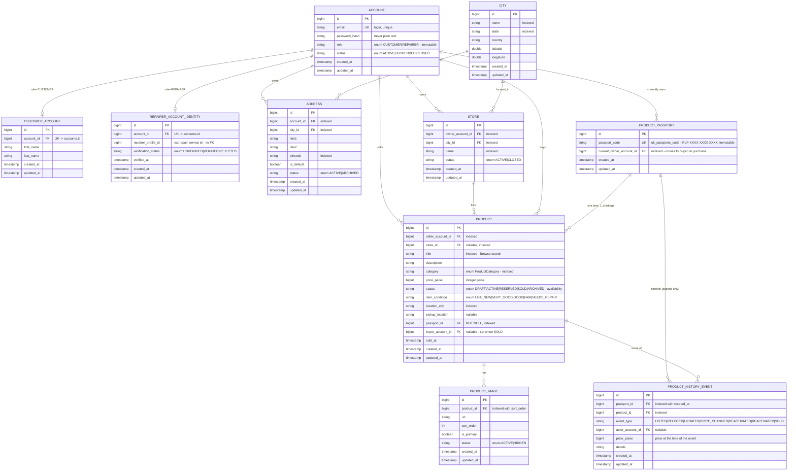
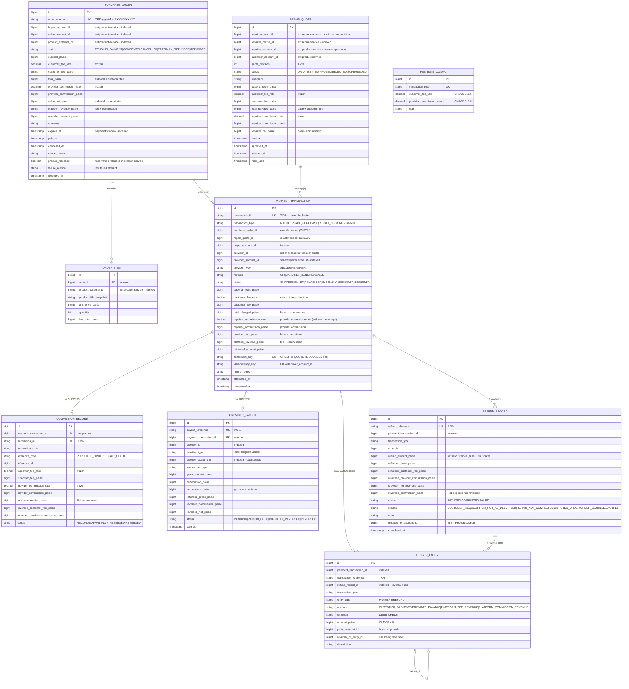
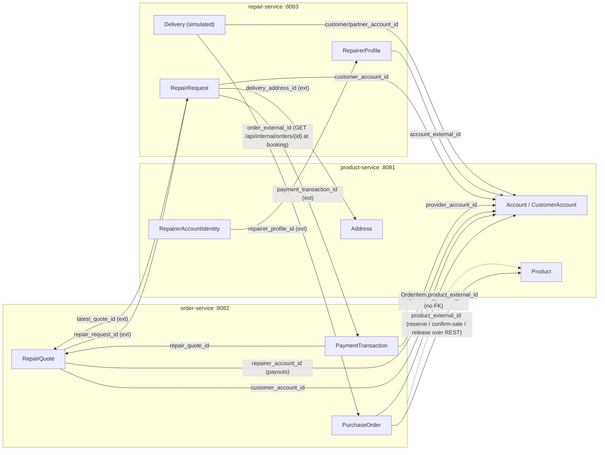

# ReLoop — ER Diagrams (Mermaid)

Authoritative data-model diagrams for the three microservices. Each service owns
its own database — there are **no cross-database foreign keys**; cross-service
links are plain `Long` external IDs.

## 1) product-service — DB `reloop_product`

## 2) order-service — DB `reloop_order`

All money columns are `bigint` paise and all rates are `decimal(8,6)`. Each order, quote, payment, commission and
payout row keeps the rates that were in force when it was created (see docs/PAYMENTS.md).

## 3) repair-service — DB `reloop_repair`

```mermaid
erDiagram
    REPAIRER_PROFILE ||--o{ REPAIR_SERVICE : offers
    REPAIRER_PROFILE ||--o{ REPAIRER_PROFILE_CATEGORY : "repair categories"
    REPAIRER_PROFILE ||--o{ REPAIRER_WORKING_HOURS : "opening hours"
    REPAIRER_PROFILE ||--o{ REPAIRER_REVIEW : rated
    REPAIRER_PROFILE ||--o{ REPAIR_REQUEST : receives
    REPAIRER_PROFILE ||--o{ SPARE_PART : stocks
    REPAIR_SERVICE ||--o{ REPAIR_REQUEST : "optional choice"
    REPAIR_REQUEST ||--o{ REPAIR_STATUS_HISTORY : timeline
    REPAIR_REQUEST ||--o{ REPAIR_REQUEST_IMAGE : photos
    REPAIR_REQUEST ||--o{ INVENTORY_MOVEMENT : "parts used"
    REPAIR_REQUEST |o--o{ DELIVERY : "repair legs (simulated)"
    DELIVERY ||--o{ DELIVERY_LOCATION_POINT : "coordinate history"
    SPARE_PART ||--o{ INVENTORY_MOVEMENT : movements
    REPAIRER_PROFILE ||--o{ INVENTORY_MOVEMENT : owns

    REPAIRER_PROFILE {
        bigint id PK
        bigint account_external_id UK "ext product-service - no FK"
        string business_name "indexed - search"
        string description
        string specialties
        string phone
        string address_line "workshop location"
        string city "indexed"
        string pincode
        double latitude "Leaflet/OSM"
        double longitude "Leaflet/OSM"
        string service_hours
        boolean accepts_in_person "delivery mode"
        boolean accepts_pickup_drop "delivery mode"
        boolean accepts_shipping "delivery mode"
        string verification_status "enum UNVERIFIED|VERIFIED|REJECTED"
        string status "enum ACTIVE|INACTIVE|SUSPENDED - indexed"
        string availability "enum AVAILABLE|BUSY|UNAVAILABLE"
        string availability_note
        bigint starting_price_paise "min active service price - sort"
        double rating_average "summary of reviews"
        int rating_count
        boolean profile_complete "listed in search when ACTIVE and complete"
        boolean is_demo "seeded demo data"
        timestamp created_at
        timestamp updated_at
    }
    REPAIRER_PROFILE_CATEGORY {
        bigint repairer_profile_id FK
        string category "enum RepairServiceCategory - indexed"
    }
    REPAIRER_WORKING_HOURS {
        bigint repairer_profile_id FK
        string day_of_week "MONDAY..SUNDAY"
        time opens_at
        time closes_at
    }
    REPAIRER_REVIEW {
        bigint id PK
        bigint repairer_profile_id FK "indexed with created_at"
        int rating "CHECK 1-5"
        string comment
        string reviewer_name
        bigint customer_account_external_id "ext - nullable"
        boolean is_demo
        timestamp created_at
        timestamp updated_at
    }
    REPAIR_SERVICE {
        bigint id PK
        bigint repairer_profile_id FK "indexed with status"
        string name
        string description
        string category "enum RepairServiceCategory - indexed"
        bigint estimated_price_paise "nullable"
        string price_type "enum FIXED|STARTING_FROM"
        int estimated_days
        string status "enum ACTIVE|INACTIVE"
        timestamp created_at
        timestamp updated_at
    }
    REPAIR_REQUEST {
        bigint id PK
        string request_number UK "uk_requests_number"
        bigint customer_account_id "ext product-service - indexed"
        bigint repairer_profile_id FK "indexed with status"
        bigint repair_service_id FK "nullable"
        bigint delivery_address_id "ext product-service - no FK"
        string delivery_mode "enum IN_PERSON|PICKUP_DROP|SHIPPING"
        string item_category "enum RepairServiceCategory"
        string item_description
        string problem_description
        string customer_notes
        string inspection_notes
        string close_reason "reject or cancel reason"
        string status "12 RepairStatus values - indexed"
        bigint latest_quote_id "ext order-service - no FK"
        int quote_revision "snapshot of current quote"
        bigint quote_base_amount_paise "snapshot"
        bigint quote_customer_fee_paise "snapshot"
        bigint quote_total_payable_paise "snapshot"
        bigint quote_repairer_commission_paise "snapshot"
        bigint quote_repairer_net_paise "snapshot"
        string quote_summary "snapshot"
        int quote_estimated_days "snapshot"
        timestamp quote_sent_at "snapshot"
        bigint payment_transaction_id "ext order-service - no FK"
        bigint version "optimistic lock"
        timestamp accepted_at
        timestamp inspected_at
        timestamp quoted_at
        timestamp approved_at
        timestamp paid_at
        timestamp in_progress_at
        timestamp completed_at
        timestamp closed_at
        timestamp created_at
        timestamp updated_at
    }
    REPAIR_REQUEST_IMAGE {
        bigint repair_request_id FK
        string image_url "demo-images path or https"
        int position "display order"
    }
    REPAIR_STATUS_HISTORY {
        bigint id PK
        bigint repair_request_id FK "indexed with created_at"
        string from_status "nullable on first entry"
        string to_status "enum RepairStatus"
        string changed_by "enum CUSTOMER|REPAIRER|SYSTEM"
        bigint changed_by_account_id "ext product-service"
        string note
        timestamp created_at
        timestamp updated_at
    }
    SPARE_PART {
        bigint id PK
        bigint repairer_profile_id FK "API repairerId; UK with sku"
        string sku "unique per repairer, generated if omitted"
        string name "API partName, indexed"
        string category "enum SparePartCategory"
        string description
        bigint unit_cost_paise "API unitCost, integer paise, CHECK >= 0"
        int stock_quantity "API quantity, CHECK >= 0"
        int reorder_level "API lowStockThreshold, CHECK >= 0"
        string status "enum ACTIVE|DISCONTINUED"
        timestamp created_at
        timestamp updated_at
    }
    INVENTORY_MOVEMENT {
        bigint id PK
        bigint repairer_profile_id FK "API repairerId, indexed with movement_date"
        bigint spare_part_id FK "indexed with created_at"
        bigint repair_request_id FK "nullable, required for USED_IN_REPAIR"
        string movement_type "STOCK_IN|USED_IN_REPAIR|ADJUSTMENT"
        int quantity_change "signed, CHECK <> 0"
        int stock_after "audit snapshot, CHECK >= 0"
        bigint unit_cost_paise "cost at movement time"
        string note
        timestamp movement_date "API movementDate"
        timestamp created_at
        timestamp updated_at
    }
    DELIVERY {
        bigint id PK
        string tracking_number UK "TRK-SIM-yyyyMMdd-XXXXXXXX"
        string delivery_type "STORE_TO_CUSTOMER|CUSTOMER_TO_REPAIRER|REPAIRER_TO_CUSTOMER"
        bigint repair_request_id FK "nullable - repair legs; UK with type"
        bigint order_external_id "ext order-service - no FK; UK with type"
        string reference_number "RR-... or ORD-..."
        bigint customer_account_id "ext - buyer or repair customer"
        bigint partner_account_id "ext - seller or repairer"
        bigint booked_by_account_id
        string origin_code "demo location snapshot"
        double origin_latitude
        double origin_longitude
        string destination_code "demo location snapshot"
        double destination_latitude
        double destination_longitude
        double route_distance_km "straight line x road factor"
        double current_latitude "simulated"
        double current_longitude "simulated"
        int simulation_step "0..7"
        int progress_percent
        string status "BOOKED|PICKED_UP|IN_TRANSIT|NEAR_DESTINATION|DELIVERED"
        timestamp estimated_arrival_at
        timestamp picked_up_at
        timestamp delivered_at
        timestamp last_advanced_at
        bigint version "optimistic lock"
        timestamp created_at
        timestamp updated_at
    }
    DELIVERY_LOCATION_POINT {
        bigint id PK
        bigint delivery_id FK "UK with sequence_no"
        int sequence_no "0 = booking"
        string status
        double latitude "simulated"
        double longitude "simulated"
        int progress_percent
        double remaining_km
        string note
        bigint recorded_by_account_id
        timestamp recorded_at "append-only"
    }
```

## 4) Cross-service references (external IDs only — never FK)

