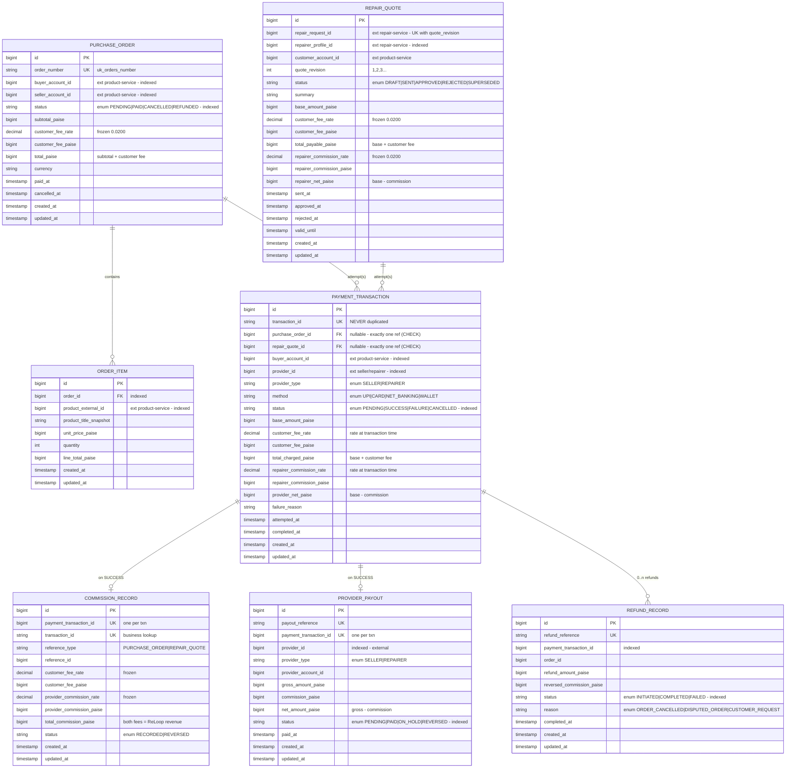
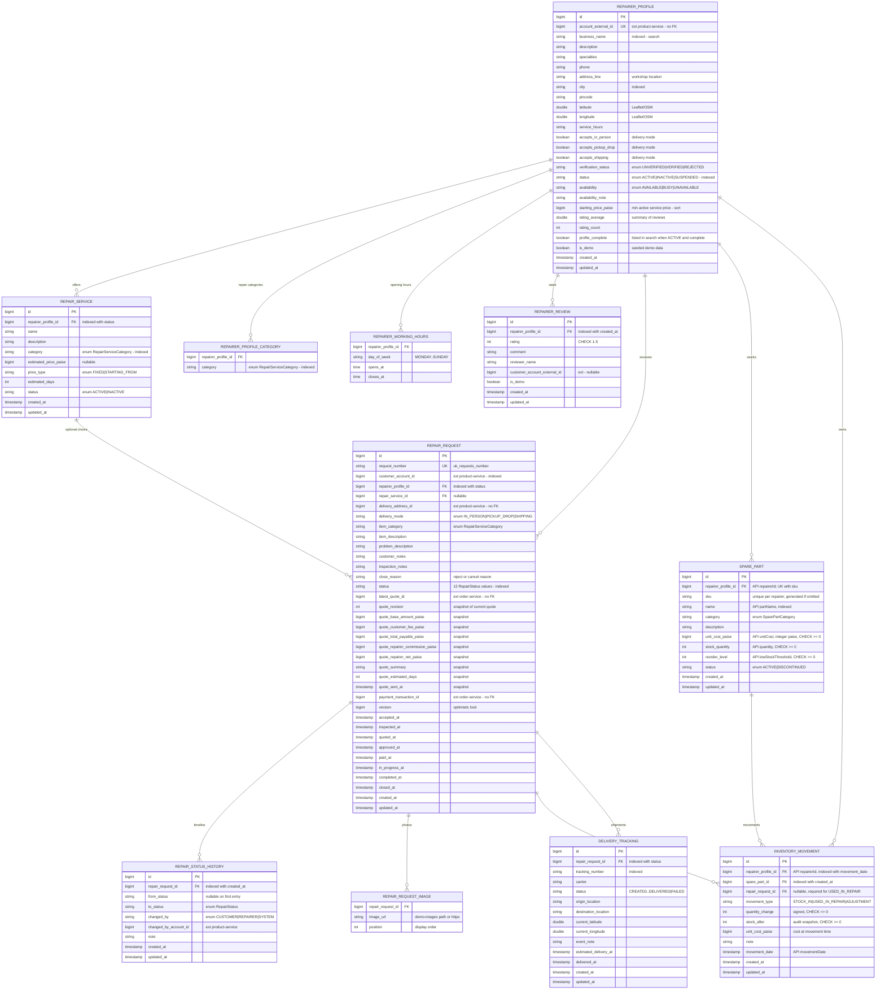
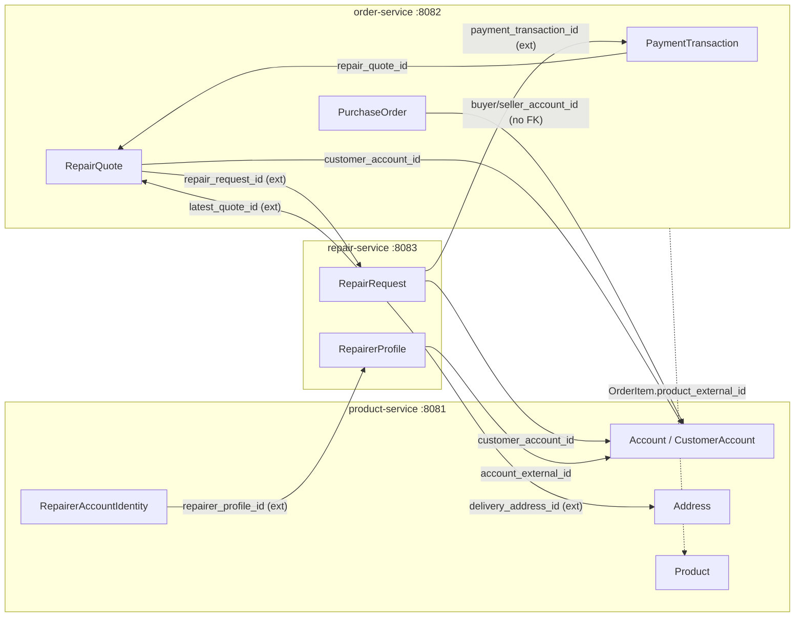

# ReLoop — ER Diagrams (Mermaid)

Authoritative data-model diagrams for the three microservices. Each service owns
its own database — there are **no cross-database foreign keys**; cross-service
links are plain `Long` external IDs.

## 1) product-service — DB `reloop_product`

## 2) order-service — DB `reloop_order`

## 3) repair-service — DB `reloop_repair`

## 4) Cross-service references (external IDs only — never FK)

